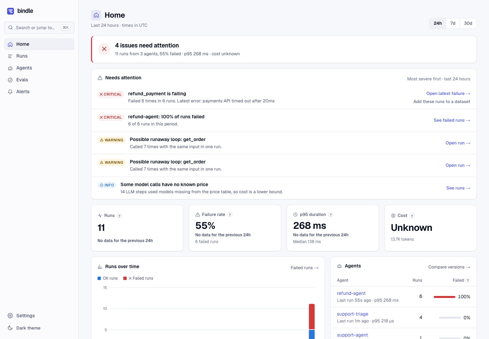
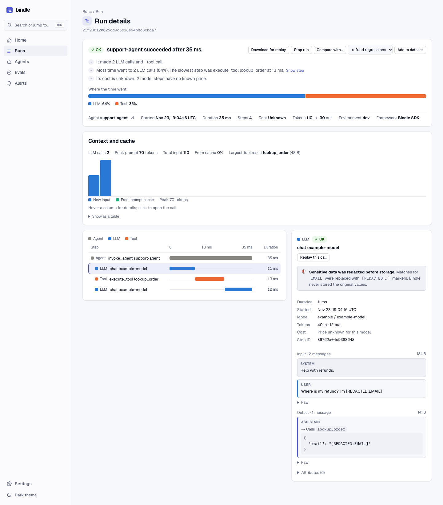

# Bindle

Observability for AI agents: every step an agent takes (LLM calls, tool calls, retrievals, decisions, handoffs) in one trace, with failures, loops, latency and cost explained in plain language.

```python
import bindle
bindle.init(agent="support-triage")   # reads BINDLE_API_KEY; a no-op without it
```

## The console

Five places to look (**Home**, **Runs**, **Agents**, **Evals**, **Alerts**) and one to configure (**Settings**: connect an agent, ingest keys, SDK settings, agent limits, model prices). `⌘K` jumps to any page, a pasted trace ID, or an agent's runs. Light and dark themes follow your OS, with a toggle in the sidebar.

**Home** answers "is anything wrong?" in one line, then lists what needs attention, most severe first: steps that keep failing (grouped, with each distinct error), agents with a high failure rate, runaway loops, runs with far more steps or cost than that agent's typical run, agents spending a large share of their budget on runs that didn't succeed, and model calls with no known price. Each item links to the exact run or step to open. Key numbers are compared with the previous period, and every metric has a plain-language definition behind its `?`.



**Run details** opens with a summary of what the run did: how many LLM and tool calls, what failed and why, whether a retry worked, possible loops, where the time went, and what it cost. Every line links to its step; the waterfall and the selected step's inputs and outputs are below, with the root-cause step selected by default. When the failure traces back to an earlier step, the summary names it ("Likely cause: step 3 — lookup_order returned nothing, and step 4 answered without it") and selects it: a tool result that came back empty or failed and a later LLM call carried on without it, a tool the model called with arguments it rejected, the same call failing the same way on every retry, an answer cut off at the model's output token limit, or a prompt that grew too large (often after one huge tool result).

**Compare runs** (`Compare with…` on any run) lines up two runs' steps and says where their paths first diverge ("The runs match for the first 4 steps, then diverge: A calls refund, B calls escalate"), which steps only one run took, how often each tool was called in each, and what changed in the steps both took: status, duration, tokens, cost, model and tool arguments.


**Context and cache** (on runs with several LLM calls) shows each call's prompt size and how much came from the prompt cache, the largest tool results, and plain hints: the prompt grew 25×, only 5% was cached, a 64 KB tool result is carried in every later prompt.

**Agents** compares an agent's versions (failure rate, cost per run, p95, steps, cache share, tool errors, each against the previous version), shows how the newest version's path changed ("v2 calls search 3.0× as often per run (2.4 vs 0.8)", tools it started or stopped calling) with a link to compare a recent run of each version, and lists tool health: failures, bad-argument errors (the model misread the schema), latency and result size, for SDK tools, MCP tools and AgentCore Gateway tools alike.

**What users ask about** (on the Agents page) lists topics that are new or appear in a clearly larger share of an agent's runs than in the period before, with example runs, plus how many runs had a user message and whether messages got longer. It reads the end user's message of each run (the last user message sent to the model, or the agent's input), counts each run once, and uses word statistics in OpenSearch, not a model. The weekly digest includes the rising and new topics.

**Security signals** flag steps worth a second look: possible prompt injection (a tool result or retrieved document that tells the model to ignore its instructions, reveal its system prompt, hide something from the user or take on an unrestricted role, or that carries chat control tokens or invisible text), a credential that surfaced in a result (Bindle redacts it before storage and keeps only a count), and possible data exfiltration (a tool call with a very long URL query string or encoded blob, or sensitive data passed to a tool that sends messages or requests). They show on Home, in the run summary and as a badge on the step, each with a plain explanation; a **Security signal** alert rule notifies your channels. Detectors are deliberately conservative and are signals to review, not verdicts.

**Sessions** group a conversation's runs (one session ID) into a chat view with how it ended and what the user said (`bindle.feedback()` thumbs and ratings); Home flags conversations where users were unhappy. **Search** finds runs by what was said, what a tool returned, or the error.

**Linked runs** connect work that doesn't fit in one trace: a run that waits in a queue or for a human's approval, hands over to another agent, or calls tools on an MCP server. Store `bindle.context_token()` with the work and call `bindle.resume(token)` where it continues (hours later or in another service); the run page then lists what it continued from, continued in, or handed off to, and the summary says so. MCP calls carry the trace in `params._meta` (`bindle.inject_mcp_meta()` and `bindle.mcp_server_context()`), and HTTP calls between agents use the standard `traceparent` header ([`docs/integrations/multi-agent.md`](docs/integrations/multi-agent.md)).

**Evals** grade runs without calling a model: checks such as "output contains", "matches a pattern", "valid JSON", "tool was (not) called", "at most N steps", "costs at most" or "no step failed". They run on **datasets** saved from runs (copies that outlive trace retention) and on a sample of each version's recent runs, shown per version on the Agents page. Model-graded scores run in your own environment: export a dataset as JSON Lines, grade it with your judge, and send results with `bindle.score(name, value, trace_id=…)`. Bindle never holds your model keys. `bindle eval` runs an agent on a dataset in CI and fails the pull request when the pass rate drops (`examples/ci/`). Scores from any OpenTelemetry evaluator arrive as the standard `gen_ai.evaluation.result` event ([`docs/integrations/evaluations.md`](docs/integrations/evaluations.md): Azure AI Foundry, Vertex AI, AgentCore).

**Production problems become eval cases** in one step: from a failure group on Home, conversations users disliked (Sessions), failed scores, or an agent's failed runs, **Add these runs to a dataset** copies up to 50 recent matching runs into a new or existing dataset, each labelled with where it came from. Bindle proposes checks that would have caught them (no step fails, the error text doesn't reach the user, the tool good runs always call is called, a step budget against runaway loops, valid JSON when good runs return JSON), shows how many of the runs each one fails, and saves only the ones you keep.

**Outcome economics** answers "what does one good result cost?". Send `bindle.outcome("ticket_resolved")` (or `success=False`) when a run does, or doesn't, do its job; the Agents page then shows each version's cost per successful outcome and its wasted spend (failed runs and failed outcomes). Agents that send no outcomes count a run as successful when no step failed and no user gave it a thumbs down, and the page says which definition it used. Unpriced model calls are never estimated: amounts that include them are shown as lower bounds.

**Replay** re-runs one captured LLM call with an edited prompt or another model, using a provider key you paste for that request only (never stored), and shows the answer, tokens, cost and latency next to the original.

**Agent limits** pause an agent, cap steps or tokens per run, stop a run that calls the same tool with the same arguments more than N times (a loop guard), or set a daily budget. **Stop run** on a run's page stops that one run. They take effect where the agent calls `bindle.check_limits()` (Python) or `checkLimits()` (TypeScript), which raises an error the agent can handle; Bindle never stops an agent anywhere else. The SDK refreshes its settings about once a minute, so a stop or a new limit arrives within about a minute. Budgets use priced spend since 00:00 UTC and notify your alert channels once a day.

**Replay with recorded tools**: **Download for replay** on a run's page saves its input and every tool call (arguments, result, or the error) as a cassette file. `bindle.Cassette` (Python) or `Cassette` (TypeScript) re-runs your agent on that input with each tool answered from the recording, so a prompt, model or code change can be tried on a real failure without touching live systems, and `cassette.report()` shows where the new run took a different path ([`examples/sdk/replay_with_cassette.py`](examples/sdk/replay_with_cassette.py)).

**Step inputs and outputs** show as a conversation (system, user, assistant and tool messages, tool calls with their arguments) for every supported framework, with the raw text one click away. Sensitive values are redacted before storage. When content is missing, the console says why: content capture is off for the workspace, off in the agent's code, or the framework doesn't send it by default (with the exact setting to turn on).



**Cost** comes from published list prices (`backend/pricing.json`: Anthropic and OpenAI, with each entry's source and date, including long-prompt tiers), or from **Model prices** in Settings, where a workspace enters what it actually pays (discounts, batch, Bedrock, Vertex, Azure or self-hosted models). For Bedrock it shows AWS's public list prices for a region (global and in-region tiers) to copy from. A weekly job (`bindle-prices check`) compares `pricing.json` with the providers' pricing pages and opens an issue when one changes. Cost is computed when a step arrives, so price changes never rewrite history. Models without a known price are shown as unknown, never estimated.

Design rationale, colors and accessibility checks: [`docs/design/console.md`](docs/design/console.md). Brand colors, type and logo rules: [`brand/BRAND.md`](brand/BRAND.md).

## Repository layout

| Path | What it is |
|---|---|
| [`backend/`](backend/) | Go services: `bindle-ingest`, `bindle-api`, `bindle-processor`, `bindle-alerts`, `bindle-migrate` |
| [`console/`](console/) | Next.js console |
| [`brand/`](brand/) | Brand guide ([`BRAND.md`](brand/BRAND.md): colors, step-type palette, type, logo rules, voice), design tokens (`tokens.css`, `tokens.json`) and logo files |
| [`site/`](site/) | Product website: plain HTML, one stylesheet on the brand tokens, no build step ([preview and deploy](site/README.md)) |
| [`sdks/python/`](sdks/python/) | `bindle-sdk` for Python, plus the `bindle init` CLI and `bindle mcp` server |
| [`sdks/typescript/`](sdks/typescript/) | `@bindle-ai/sdk` for Node.js |
| [`deploy/local/`](deploy/local/) | Docker Compose stack for development |
| [`deploy/aws/`](deploy/aws/) | AWS CDK stack |
| [`deploy/connectors/cloudwatch-spans/`](deploy/connectors/cloudwatch-spans/) | Customer-deployed forwarder for AWS service spans (AgentCore Gateway, Policy, Identity) from CloudWatch to Bindle |
| [`deploy/otel-collector/`](deploy/otel-collector/) | Optional OpenTelemetry Collector config for regulated tenants |
| [`examples/`](examples/) | `sdk/`: quickstart, demo agent and linked runs (approval, handoff, MCP). `frameworks/`: LangGraph, Strands, Google ADK and Microsoft Agent Framework agents with stub models. `agentcore/`: a Strands agent for Amazon Bedrock AgentCore Runtime. `ci/`: a GitHub workflow that runs `bindle eval` on pull requests |
| [`docs/`](docs/) | [Architecture](docs/architecture.md), [console design](docs/design/console.md), [evaluation integrations](docs/integrations/evaluations.md) (Azure AI Foundry, Vertex AI, AgentCore), [multi-agent tracing](docs/integrations/multi-agent.md) (queues, approvals, handoffs, MCP), [plans and open items](docs/plans/) |
| [`.github/workflows/`](.github/workflows/) | CI: every test suite, container builds and `cdk synth` on each pull request; a weekly check of the model pricing pages; publishing `site/` to GitHub Pages on changes to `main` |

## Run it locally

Needs Docker, Go 1.25+, Node 20+ and Python 3.9+. Go dependencies are downloaded at build time (not committed); on networks that block `proxy.golang.org`, set `GOPROXY=direct` (the local Docker stack already does).

```bash
make up          # local stack: OpenSearch, PostgreSQL, ingest, API, alerts
make console     # console at http://localhost:3000 (signed in as the local dev workspace)
make demo        # send demo runs, including one with a runaway loop
```

Then point any agent at it:

```bash
set -a; . deploy/local/.env; set +a      # BINDLE_API_KEY and BINDLE_ENDPOINT
pip install -e sdks/python
python examples/sdk/quickstart.py
```

`make help` lists every target. Details: [`deploy/local/`](deploy/local/).

## Tests

```bash
make test        # Go (vet + tests), Python SDK, TypeScript SDK, console (typecheck, tests, build)
```

CI runs the same checks, plus the control-plane database tests, both container images and `cdk synth`, on every pull request.

Each part can also be run alone (`make test-backend`, `test-python`, `test-typescript`, `test-console`). Integration tests against the local stack are described in [`backend/`](backend/).

## Deploy

See [`deploy/aws/`](deploy/aws/): ingest, a private API, the console behind HTTPS with Cognito sign-in, and the data stores, all on ARM (Graviton) Fargate tasks. `cdk deploy` builds the images locally, so Docker must be running; pass `-c goproxy=direct` on networks that block `proxy.golang.org`. Deploying creates paid AWS resources.

## License

Bindle is licensed under the [Apache License, Version 2.0](LICENSE). See [NOTICE](NOTICE) for attributions of the backend's dependencies, such as the PostgreSQL driver (MIT) and the Anthropic Go SDK (Apache 2.0). Contributions are accepted under the same license; see [CONTRIBUTING.md](CONTRIBUTING.md).
